# The delivery loop

[How the plugins work](how-the-plugins-work.md) describes the lifecycle the plugins cover today: set up, specify,
build, ship, maintain. This page is the map of where the family is going: a loop of three phases in which the work
before a story exists, and the work after a change has shipped, are covered as well as the build in the middle.

Most of what the loop adds is designed but not built. Every part below says what ships today and what is planned,
with the issue that tracks it, so you can tell a mechanism from an intention. The page was written on 2026-11-20 and
is updated by the epic that lands each part.

Each phase has its own frame and banner: orange for Intent and Synthesis, purple for Execution, blue for Monitor
and Learn. Read it from the top, round through Execution, and back. Inside a frame, the fill of a step says how
much of it exists:

| Step | Meaning |
| --- | --- |
| Dark green | Ships today |
| Light green | Ships in part; the rest is planned |
| White | Designed and planned, not built |
| White, dashed | Not designed yet |

A rounded step is a Feature and a six-sided step is an Enabler; [Feature and Enabler](#loop-feature-enabler)
tells them apart. A thick grey arrow is the path a piece of work takes. A dotted arrow is something a step is
judged against. The blue arrows close the loop: what is learnt after shipping returns to the first phase, as new
entries in the backlog and, more rarely, as evidence that the direction itself should change.

## The three phases {#loop-phases}

| Phase | What happens in it | Ships today | Planned | Not designed |
| --- | --- | --- | --- | --- |
| **Intent and Synthesis** | Direction is written down, ideas are captured and ordered, a Feature is defined, designed and made ready | Personas; refinement of a filed issue to a ready story | Charter (#3195), issue types and board (#3196), grooming (#3197), reference documents (#3198), the two-stage refinement (#3199), roadmap (#3200), component library support (#3253), feature mockups (#3261), protection needs (#3269) | Threat and risk analysis, privacy records |
| **Execution** | A ready story is built, reviewed, shipped | Build, the review loop, bot-authored PRs, the Approver, documentation checks | Work across a product's repos (#3201) | — |
| **Monitor and Learn** | The shipped product is kept healthy and what is learnt returns as new work | Maintenance: security findings, dependency updates, code quality | Bugs as a maintenance concern, a fixed order, unattended scheduled runs (#3210) | Observing the running product: monitoring, cost, incident response |

## Feature and Enabler {#loop-feature-enabler}

One backlog and one roadmap hold two kinds of planned work. In the diagram the rounded step is the Feature and the
six-sided step is the Enabler; both end in the same technical stage and are built the same way. *The two types
are #3196, the roadmap #3200.*

| | Feature | Enabler |
| --- | --- | --- |
| What it is | Something a user can see or do | Work no user sees, which keeps or moves the product on its target architecture |
| Why it exists | The charter and a persona call for it | The target architecture says so, or has changed |
| Judged against | Charter and personas | Target architecture |
| Owner | Product owner | Architect |
| Design step | Yes, when it has a UI | No |
| Typical source | An idea, a request, something learnt from use | A dated change to the target architecture; a component the library lacks |
| Order | Set by the product owner | Set by the product owner, within the architect's *must precede* and *must be done by* marks |

Grooming never weighs an Enabler against the charter, and never weighs a Feature against the architecture alone.
An idea becomes one or the other, or is dropped, when it is promoted.

## The longer path of a Feature {#loop-feature-path}

Today a change starts at "there is an issue". In the loop it starts earlier and ends later:

1. **Direction exists first.** A product has a charter, a persona registry and a protection-needs assessment. They
   are written once in an interview and changed deliberately, with a dated log. Every later step is judged against
   them. *Personas ship today; charter #3195, protection needs #3269.*
2. **An idea is captured** in a sentence or two, with no interview. It is invisible to the roadmap and to the build
   until it is promoted. *#3196.*
3. **The backlog is groomed and ordered** against the charter: keep, refine, or close with a stated reason; then
   one ordered roadmap. *#3197, #3200.*
4. **Product stage: the Feature is defined** — who, why, use case, acceptance criteria, non-functional
   requirements — and names the kinds of information it touches. A kind the protection-needs assessment does not
   know stops it there. *Refinement ships today as one step; the split is #3199, the information check #3269.*
5. **Design step, for a Feature with a UI.** Mockups of every affected view and state are composed from the declared
   component library, filled with invented data, checked against the styleguide, and approved by a human before
   anything is built. *#3261, on top of #3253.*
6. **Technical stage: the story is made ready** — surface, dependencies, size, test layout — deciding the *how* from
   the linked reference documents and stopping only for a gap none of them covers. *Readiness ships today; the
   unattended technical stage is #3199, the reference documents #3198.*
7. **Build, review, ship.** Unchanged: `/development:resolve-issue`, the review loop, a bot-authored PR, approval,
   merge. For a Feature with a mockup, the built view is compared against it. *Ships today; the comparison is
   #3261.*
8. **Maintain.** Scanner findings, dependency updates and filed bugs are worked in a fixed order, on demand or
   on a schedule. *Ships today on demand; #3210.*
9. **Observe and learn.** What the running product shows — failures, cost, use — returns to step 2 as ideas and
   bugs. When it contradicts the charter, a persona or the protection-needs assessment, it returns to step 1 as
   evidence for a deliberate change there; nothing changes a direction document on its own. *Not designed.*

## Who decides what {#loop-roles}

The loop puts a human at the edge of each phase and asks each one only for what is theirs to decide.

| Role | Decides | Is asked |
| --- | --- | --- |
| Product manager | Charter, personas, protection needs | In an interview |
| Product owner | What a Feature is, the order of the backlog, whether a mockup is right | About *what* and *why* only |
| Architect | Target architecture, styleguides, the component library; the order constraints of technical work | Only when a gap appears |
| Engineer | Nothing routinely; watches the build and steps in | When a run stops for a human |
| Operator | Which reported bugs are real; which fixes may ship | Before a fix, never during |

## How the family is organised for it {#loop-organisation}

**One marketplace, plugins by role.** The `product` plugin holds the work of the first phase and can be installed
without the `development` family; the `development-*` plugins hold execution and maintenance. Work on the running
product, once designed, becomes a third family beside them.

**Five layers.** The plugins are coupled only through the top two and the bottom one:

| Layer | What it holds |
| --- | --- |
| Documents | Charter, personas, protection needs, target architecture, styleguides — what work is judged against |
| Queue | Typed issues and one board per product, every status derived from issue state |
| Roles | The plugins: `product`, `development-*`, later one for operations |
| Runners | What starts work: an attended session, a scheduled unattended run, a conductor across a product's repos |
| Contracts | The versioned formats the plugins exchange, documented in `ARCHITECTURE.md` |

**The owner's documents stay the owner's.** A scale for protection needs, a styleguide, a component library, a theme
all belong to whoever uses the plugins. The family ships the mechanism and reads what a repo links; it names no
component technology and hard-codes no scale.

## Decisions behind this page {#loop-decisions}

Taken by the maintainer on 2026-11-20; each design document carries the reasoning.

- The family stays one marketplace, and stays on Claude Code. What is built beside it is a runner that starts
  sessions (#3210), not an agent framework.
- A mockup is code stored with the Feature's documents, composed only from a declared component library, checked in
  two reference themes and every display mode, and approved by a human. No design-tool files, no pixel comparison.
- A UI repo that declares a component library is held to it: no hand-built replacement, no brand value in the code.
  A missing component becomes work for the library.
- Protection needs are assessed for the whole product, on an owner-declared scale. A component is not rated; it
  states what it contributes to the whole.

## What is open {#loop-open}

- **Monitor and Learn beyond maintenance.** What is observed, where its signals come from, and whether polling in
  a scheduled run is enough.
- **Governance and risk beyond protection needs.** Threat and risk analysis, privacy records, and mapping a
  protection level to technical measures.
- **The test suite as the family widens.** The per-round cost is addressed by #2925. The per-story cost still grows
  with every plugin; splitting the CI job, running a product-only change against the product suite plus a
  cross-family contract suite, and judging agents by behaviour instead of by text are proposals, not decisions.
- **This manual's own structure.** Grouping the how-to, reference and explanation pages by the three phases is
  agreed in principle and not yet done.
