# How the plugins work

This page and the four workflow pages that follow it explain, step by step and with one diagram each, how the
family's main skills do their work: `/development:refine-issue`, `/development:resolve-issue`,
`/development:bootstrap` and `/development:maintenance`. [How the family learns](how-the-family-learns.md) then steps
back to positions, telemetry and the self-improvement loop. They are written to be read in order, or handed to
someone as a set — the same six pages are built into a standalone **workflows booklet** (`workflows.pdf` and
`workflows.epub`), attached to the rolling
[`docs-latest` release](https://github.com/timo-jakob/timos-claude-code-plugins/releases/tag/docs-latest)
next to the full manual.

They explain the *shape* of each workflow. The skills themselves are the source of truth for every rule, threshold and
exit code; the [Sources](#sources) section at the end links each one.

## Reading the diagrams {#reading-the-diagrams}

Every diagram uses one colour per kind of actor, so you can see at a glance who does a step:

| Colour | Actor | Examples |
| --- | --- | --- |
| Orange | A human | You starting a skill, answering a question, approving a PR |
| Blue | The conductor — the skill running in your Claude Code session | `resolve-issue` branching, committing, posting a comment |
| Purple | A subagent — a separate model call with one job | `story-readiness`, `issue-refiner`, `round-panel` |
| Green | A bot identity, or a successful end | The Maintenance App opening a PR; *Merged on green CI* |
| Grey | A script, a test gate, GitHub, or an artifact | `detect-stack.sh`, the test gate, `docs/personas.md` |
| Red | A stop: a halt, a park or an escalation | *needs-refinement label*, *Escalation* |

Rounded boxes are where a flow starts or ends, diamonds are decisions, and a frame groups the steps of one
phase or loop. Each workflow page has one diagram; the steps under it describe each box in order.

## The lifecycle, end to end {#the-lifecycle-end-to-end}

The skills cover the whole life of a change, from setting a repository up to keeping it healthy after the change has
shipped. Every change, whichever skill produced it, ships the same way.

1. **Set up — once per repository.** `/development:bootstrap` installs the quality and security toolchain — CI
   workflows, scanners, hooks, the docs stack — and opens it as a PR ([How bootstrap works](workflow-bootstrap.md)).
   `/development:define-personas` writes the persona registry, `docs/personas.md`. Personas are optional, but they are
   what lets refinement write test data that looks like real input ([Personas](#personas-who-a-story-serves) below).
2. **Specify.** You file an issue or an epic, as you would for a human colleague. Before anything is built, the
   `story-readiness` agent judges whether it is specified well enough. A story it sends back gets the
   `needs-refinement` label and the gate's questions, and `/development:refine-issue` walks you through answering them
   until it is ready ([How refine-issue works](workflow-refine-issue.md)).
3. **Build — on your machine.** `/development:resolve-issue` branches, implements the story with its acceptance tests
   and docs, runs the test gate, and puts the change through a local review loop until it converges
   ([How resolve-issue works](workflow-resolve-issue.md)). No PR exists yet.
4. **Ship.** The change arrives as a PR authored by the Maintenance App bot, with squash auto-merge armed. The Approver
   bot or a human approves it, and it merges once CI is green.
5. **Maintain — continuously.** On merged `main`, the toolchain keeps reporting: scanner findings, dependency and
   vendor PRs, coverage. `/development:maintenance` works through them one small PR at a time, and those PRs ship the
   same way as step 4. What needs a human decision becomes an issue, and re-enters the cycle at step 2
   ([How maintenance works](workflow-maintenance.md)).

## The cast {#the-cast}

Three kinds of actor share the work, and the split between them is deliberate: a human decides, the conductor acts,
and subagents judge.

### Human roles {#human-roles}

- **The driver** is whoever types the slash command. The driver answers the questions a skill cannot answer from the
  repository, approves every rewrite of an issue, chooses between a park and another round, and grants more review
  rounds when a run runs out of budget.
- **The human approver** approves PRs where no bot may. On a Claude-plugin repository that is every PR by default;
  even with the plugin Approver opted in, a PR that changes workflows or the approval machinery, or that carries review
  residue, still goes to a human. On an app repository the Approver bot takes this role — see
  [The Claude Approver](claude-approver.md).

### Bot identities {#bot-identities}

- **The Maintenance App** (`claude-maintenance-<owner>[bot]`) is the *writer*. The conductor mints a short-lived token
  for it, and through it pushes the branch, opens the PR, and arms squash auto-merge. Because the bot authors the PR,
  you are free to approve it — GitHub does not let anyone approve their own PR.
- **The Approver App** (`claude-approver-<owner>[bot]`) is the *reviewer*. It acts through the
  `/development-<lang>:approve` skill, normally run from your own session, reads the review dossier in the PR body,
  and posts APPROVE, REQUEST_CHANGES or COMMENT.
- **Your own `gh` login** is used for what is yours to say: refine-issue edits the issue body and posts comments as
  you, not as a bot, and never through a PR.

### The agent cast {#the-agent-cast}

A subagent is a pure function of one turn: it reads the repository and the input it is handed, and returns JSON. It
never writes to GitHub and never commits — every side effect belongs to the conductor that called it. The model is
the one each agent's frontmatter names.

| Agent | Model | Used by | Its one job |
| --- | --- | --- | --- |
| `story-readiness` | fable | resolve-issue, refine-issue | Judge whether a story is specified well enough to build; propose or validate its story spec; raise persona advisories |
| `issue-refiner` | fable | refine-issue | One refinement turn: explain each objection, ask scored questions, draft the rewrite and the story spec |
| `persona-definer` | fable | define-personas | One elicitation turn: propose personas from repo evidence, challenge coverage gaps, draft the registry |
| `round-panel` | opus | resolve-issue | Run one review round's panel: one reviewer per dimension of the repo type's review |
| `round-decide` | opus | resolve-issue | Run the commands reviewers attached to claims about tool results, and settle them |
| `round-risk` | opus | resolve-issue | Optionally weigh each finding's probability and impact, demoting low-risk warnings |
| `round-fix` | fable | resolve-issue | Apply a fix pass to the working tree |
| `commit-message` | sonnet | commit | Write the commit message from the diff |
| `bootstrap-security-reviewer` | fable | bootstrap | Review the planned workflows for permission, secret and pinning risks |
| `bootstrap-config-consistency` | opus | bootstrap | Cross-check the plan: Sonar keys, job ids against branch protection, secrets against `SETUP.md` |
| `bootstrap-idempotency-reviewer` | opus | bootstrap | Recommend skip, overwrite or merge for every file that already exists |
| `bootstrap-validator` | haiku | bootstrap | Validate what was written: YAML/JSON parses, no leftover placeholders, references resolve |
| `<lang>-maintenance-planner` | opus | maintenance | Rank findings and group them into one PR per tool and agent |
| `<lang>-coverage-improver` | fable | maintenance | Raise test coverage before a refactor or a major upgrade is allowed to land |
| Fixers, triage and upgrade agents | haiku – fable | maintenance | Do one group's work in its own worktree (see the maintenance page) |
| `<lang>-ci-fixer` | opus | maintenance | Fix a red CI run on a maintenance PR, at most three times |
| `<lang>-approver`, `claude-plugin-approver` | fable | approve skills | Build a risk register and post the Approver's verdict |

## Personas: who a story serves {#personas-who-a-story-serves}

A **persona** is a short, evidence-based description of someone who uses one of the repo's surfaces — the CLI, a REST
API, a web UI — and of the values they actually type into it. The registry of them lives in
[`docs/personas.md`](../personas.md), as readable prose plus a generated `personas/v1` block that tools consume.

1. **Gather evidence.** `/development:define-personas` reads the README, the docs, existing issues, OpenAPI and proto
   specs and UI routes. It runs in *create* mode when there is no registry yet and *update* mode when there is.
2. **Elicit, one turn at a time.** The `persona-definer` agent proposes candidates grounded in that evidence and asks
   Socratic questions. It challenges gaps instead of only confirming you: a surface with no primary persona, a missing
   adversarial persona on a surface that takes untrusted input, a developer-facing surface with no API consumer.
3. **Converge.** The loop ends when every surface has exactly one primary persona, there are three to seven personas,
   nothing is left to confirm — and you approve the exact registry.
4. **Write it to the working tree.** The skill writes the prose between sentinels and a generated `personas/v1` block
   that carries a hash of that prose, so a later hand-edit makes the block detectably stale. It does not commit or
   push: the registry lands through a normal PR like any other change.
5. **Refinement consumes it.** `issue-refiner` draws test payloads from each persona's `data_traits` instead of
   `foo`/`bar`, derives corner and error cases from their shapes, and proposes UI/UX consequences from a persona's
   role, context and proficiency. When a story needs a persona that does not exist, it recommends running
   define-personas — it never invents one.
6. **Readiness only advises.** `story-readiness` reports an unknown persona, a stale registry or a missing one as an
   *advisory*. An advisory never changes the verdict; it points you at define-personas.
7. **Acceptance tests use it.** When resolve-issue builds a story that touches a surface, its acceptance tests take
   their data from the story spec's `use_case` and the referenced personas' `data_traits`.

## The four workflows {#the-four-workflows}

- [How refine-issue works](workflow-refine-issue.md) — from a story the gate sent back to a story that is ready.
- [How resolve-issue works](workflow-resolve-issue.md) — from a ready story, or an epic, to merged PRs.
- [How bootstrap works](workflow-bootstrap.md) — from a bare repository to a repository with the full toolchain.
- [How maintenance works](workflow-maintenance.md) — from scanner findings to a queue of small, merged PRs.

Above all four, [How the family learns](how-the-family-learns.md) covers what the workflows are built *towards* (the
positions), what every run records (telemetry), and how that evidence becomes the next release (the self-improvement
loop).

## Sources {#sources}

Each workflow is defined by its skill; when a page here and a skill disagree, the skill is right.

- `/development:refine-issue` —
  [`development/skills/refine-issue/SKILL.md`](https://github.com/timo-jakob/timos-claude-code-plugins/blob/main/development/skills/refine-issue/SKILL.md)
- `/development:define-personas` —
  [`development/skills/define-personas/SKILL.md`](https://github.com/timo-jakob/timos-claude-code-plugins/blob/main/development/skills/define-personas/SKILL.md)
- `/development:resolve-issue` —
  [`development/skills/resolve-issue/SKILL.md`](https://github.com/timo-jakob/timos-claude-code-plugins/blob/main/development/skills/resolve-issue/SKILL.md)
- `/development:bootstrap` —
  [`development/skills/bootstrap/SKILL.md`](https://github.com/timo-jakob/timos-claude-code-plugins/blob/main/development/skills/bootstrap/SKILL.md)
- `/development:maintenance` —
  [`development/skills/maintenance/SKILL.md`](https://github.com/timo-jakob/timos-claude-code-plugins/blob/main/development/skills/maintenance/SKILL.md)

The diagrams are generated: each `.svg` beside these pages is rendered from the `.mmd` Mermaid source next to it by
`scripts/render-diagrams.zsh`. Edit the source and re-render; never edit an SVG by hand.
