# How maintenance works

`/development:maintenance` is the entry point for *"fix everything you safely can on this project"*. It gathers what the
toolchain reports — scanner findings, dependency and vendor PRs, coverage — hands each language and topic its findings,
and works through the resulting plan **one PR at a time**: open, get CI green, get it approved, merge, sync, next.

It is split into three layers so that no layer hardcodes another's knowledge:

- the **orchestrator** (`development:maintenance`) owns detection, gathering, every git and GitHub action, and the PR
  cycle;
- a **dispatcher** per language or topic (`development-<target>:maintenance`) is a pure function of its findings: it
  validates them, runs a coverage pre-flight and returns a plan;
- **work agents** do one group of fixes each, in their own worktree.

The colour key for the diagrams is on [How the plugins work](how-the-plugins-work.md).

## From findings to a plan {#maintenance-from-findings-to-a-plan}

1. **Flags.** `--dry-run`, `--tool=<name>` or `--concern=security|dependencies|codequality` to narrow the run,
   `--batch=N` to cap the number of PRs, `--no-merge`, and `--resume` to pick up an interrupted run from its
   checkpoint.
2. **Phase 1 — detect.** `detect-stack.sh` finds the languages and markers. The `primary:` key in `.maintenance.yml`
   decides which stack gets the full pipeline; the rest are *auxiliary* and get lint-level fixes only.
3. **Phase 2 — discover targets.** A language is supported when a `gather-<lang>-findings` script exists for it. A
   topic — `claude-plugin`, `spring`, `docs`, `react`, `kubernetes`, `opentofu`, `composition` — is in play when its
   marker is present. Nothing is hardcoded: adding a gather script adds a language.
4. **Phase 2.5 — Approver feedback.** Open bot PRs on which the Approver requested changes are fixed first, by the
   agents its findings name. Bot PRs that have become conflicting are noted for the PR cycle.
5. **Phase 3 — gather findings.** Per target: a state pre-flight, then the gather script — formatters and linters,
   SonarCloud, Semgrep, CodeQL and Scorecard alerts, container scans, Dependabot, Renovate and Snyk PRs, and coverage,
   measured as part of the gather.
6. **Phase 4 — build one v2 payload per target:** the findings, the coverage, the policy (90% coverage threshold, a
   *high* severity gate) and the base branch. With `--dry-run` the payloads are printed and the run stops.
7. **Phase 6 — dispatch.** Each payload goes, unchanged, to `development-<target>:maintenance`. A dispatcher answers
   in one of three ways:
   - a **plan** — go to the PR cycle;
   - an **improver result** — coverage had to be raised first; that PR runs as *Stage 0*, and the target is
     dispatched again. Under `--no-merge` there is no Stage 0: the improver's branch stays local, the target is
     not planned, and the summary names the branch whose merge it waits on;
   - **human action required** — that target stops; the others continue.

### Inside a dispatcher {#maintenance-inside-a-dispatcher}

A dispatcher never edits code and never opens a PR. It runs the **coverage pre-flight**: a refactor finding needs the
enclosing function covered to 80%, and a major dependency upgrade needs the whole project at 90%, before either is
allowed to land. Below the bar, it spawns the coverage improver in a worktree and returns at once. Above it, the
**planner** ranks the findings by severity, file churn and closeness to entry points, and groups them — one group per
tool and agent, so each PR has a single purpose. Topic dispatchers work the same way and add their groups to the same
queue.

## The PR cycle {#maintenance-the-pr-cycle}

Groups run strictly one after another — worktree groups first, vendor-PR groups last — so every PR branches off a
`main` that already holds the previous one.

1. **Run the work agent** in its own worktree: a mechanical fixer (formatting, lint), a triage agent (Sonar, Semgrep,
   code scanning, container CVEs), an upgrade agent (a major dependency, a runtime, Spring Boot) or an advisor. Vendor
   PR triage is the exception: it acts on the existing Dependabot, Renovate or Snyk PRs directly.
2. **Open the PR as the Maintenance App,** with the repo's PR template filled in.
3. **Wait for CI.** CI is green when, once every check has settled, none is failing; a cancelled check is neutral,
   never a failure. A red run goes to the language's CI fixer, at most three times; after that the PR is escalated for
   human review and the cycle moves on.
4. **The approval gate.** With the Approver wired, it reviews and approves; without it, a human does. An Approver that
   requests changes gets two rounds of in-run fixes. If approval does not arrive in time, auto-merge is armed and the
   PR is recorded as *awaiting approval*.
5. **Merge, sync, re-verify.** Squash-merge with branch deletion, fast-forward `main`, and re-run the state pre-flight
   before the next group.

## After the queue {#maintenance-after-the-queue}

- **Phase 9 — summary.** What merged, what is awaiting approval, what was escalated or deferred, and one telemetry
  record for the run.
- **Phase 10 — issues.** One debt-tracking issue per scanner tool, kept up to date across runs, and one follow-up issue
  per PR that was deferred, escalated or merged with suppressions.

## Who does what {#maintenance-who-does-what}

| Actor | Does |
| --- | --- |
| You | Start the run, answer resume and fallback questions, approve PRs when no Approver is wired, handle escalations |
| `maintenance` (orchestrator) | Detection, gathering, payloads, dispatch, every git and `gh` action, the PR cycle |
| `development-<target>:maintenance` | Validate the payload, run the coverage pre-flight, return a plan |
| `<lang>-maintenance-planner` | Rank and group findings; read-only |
| `<lang>-coverage-improver` | Raise coverage where the pre-flight requires it |
| Work agents | Fix one group each, in its own worktree |
| `<lang>-ci-fixer` | Fix a red CI run, at most three times per PR |
| Maintenance App | Opens the PRs; force-pushes rebases of conflicting bot PRs |
| Approver App, or a human | Approves the PRs |
