# How resolve-issue works

`/development:resolve-issue` takes a GitHub issue — or an epic of issues — and drives it to a merge-ready PR authored
by the Maintenance App. It never pushes to the default branch, and it never opens a PR it has not reviewed and tested
locally first. It works the same way on every repo type the family supports: what differs per type (the test gate, the
version bump, the review panel) comes from a *resolve-profile* the skill loads for that type.

The colour key for the diagrams is on [How the plugins work](how-the-plugins-work.md).

## The gates before any code {#resolve-the-gates-before-any-code}

Nothing is branched or built until the story has passed three checks.

1. **Step 0 — classify.** The issue is an *epic* when it has native sub-issues, carries the `epic` label, or its body
   declares child issues as a task list; epics take the [epic path](#resolve-epics). A closed issue stops the run here.
2. **Step 0a — dependency precheck.** A script reads the issue's native *blocked by* links. If a blocker is still
   open, or the links form a cycle, the run stops: an unattended run labels the issue `blocked` and comments why; with
   you present, it offers guided remediation instead. It never starts the blocking issue on its own.
3. **Step 0b — readiness gate.** The `story-readiness` agent judges whether the story is specified well enough to
   build: testable acceptance criteria, bounded scope, declared dependencies, and — for a story that touches an
   interface — a use case and test cases. On NEEDS_REFINEMENT the run labels the issue `needs-refinement`, posts the
   gate's questions as a comment and stops without branching; [refine-issue](workflow-refine-issue.md) is the way back.
   On READY the gate's risk classification is carried forward to the PR and the Approver.

## From branch to merge {#resolve-from-branch-to-merge}

1. **Step 1 — branch.** A branch named `<type>/<issue>-<slug>` is created off a freshly fetched `main`.
2. **Step 1b — load the profile.** The skill detects the repo type and loads `development-<type>:resolve-profile`. The
   profile says which test gate is blessed, what a version bump means here, which review panel applies, and how a fix
   pass and the docs are handled. A type without a profile falls back to generic rules.
3. **Step 2 — implement.** The change is written from the issue's `story-spec/v1` block, or from its prose when there
   is none. Acceptance tests for the story's test cases ship in the same PR, and so do the user docs the change needs.
   A size pre-flight runs before the first edit: a change that would touch too many files, or straddle plugins, stops
   and offers a split instead.
4. **Step 3 — test gate.** The profile's gate runs: the whole test suite plus the repo's own checks (pre-commit, the C4
   currency check, a strict docs build where it applies). A red gate that cannot be fixed abandons the run.
5. **Step 3.5 — the local review loop.** A panel of reviewers examines the change, a fix pass addresses what they
   find, and the loop repeats until it converges — described in [The review loop](#resolve-the-review-loop) below.
6. **Step 4 — version bump.** Whatever the profile defines: for a Claude-plugin repo, the changed plugin's
   `plugin.json` and its marketplace entry.
7. **Step 5 — commit.** A Conventional Commit that closes the issue, with pre-commit hooks run and never skipped.
8. **Step 6 — open the PR as the bot.** The branch is rebased onto `main`, a Maintenance App token is minted, and the
   bot pushes the branch, opens the PR with a review dossier in its body, and arms squash auto-merge.
9. **Approval and merge.** On an app repository the Approver bot reviews and approves; on a Claude-plugin repository a
   human does, unless the plugin Approver has been opted in for the session. The PR merges once it is approved and CI
   is green.
10. **Step 7 — telemetry.** Every ending after step 0a — a PR, a stop, an escalation — writes exactly one record.

## The review loop {#resolve-the-review-loop}

Before any PR exists, the change goes through up to five review rounds on your machine. Each round reviews an exact,
named snapshot of the working tree, so its findings can never be about code that has since changed. The full story —
budgets, promotion, what you see while it runs — is in [The local review loop](review-loop.md).

1. **Mint the tree identity.** The conductor records exactly which tree this round reviews.
2. **Run the full test gate,** in the background, against that tree.
3. **Run the panel,** at the same time. The `round-panel` subagent starts one reviewer for each dimension of the repo
   type's review (bugs, security, tests and so on) and collects their findings.
4. **Wait for the gate.** A red gate is fixed first, by `round-fix`; that round's findings are thrown away, because
   they were about a tree that failed its tests, and the round starts again.
5. **Decide tool claims.** `round-decide` runs the commands reviewers attached to claims about what a tool would
   report, and keeps only the claims that hold.
6. **Weigh risk (optional).** When a risk threshold is set, `round-risk` weighs probability against impact and demotes
   a low-risk WARNING to a suggestion. A CRITICAL is never demoted.
7. **Consolidate.** A script merges duplicates and counts **blockers**: CRITICAL and WARNING findings. Suggestions are
   logged and waived.
8. **Fix.** With blockers left, `round-fix` applies a fix pass, bounded by the rule
   [The local review loop](review-loop.md) states for what a fix may change. The next round is a *delta*: it reviews
   only what the fix changed, and re-checks the previous round's blockers.

### How the loop ends {#resolve-how-the-loop-ends}

- **CONVERGED** — zero blockers on a *full* sweep of the change. A delta round can never converge on its own: when a
  delta finds nothing, the loop promotes one closing full sweep to confirm it. **This is the only ending that opens a
  PR.**
- **Out of budget, or not converging** — with you present, the skill asks: grant three more rounds, give guidance and
  retry, or stop. Unattended, a run whose blockers are all non-critical takes an automatic extension (#2576) and, if
  blockers survive it, stops cleanly (#2579): no PR, and its state is kept for a later run. When you stop, or an
  unattended run cannot extend, it **escalates**: the branch is pushed, no PR is opened, and the issue gets a
  `needs-human-decision` comment describing what is unresolved.

## Epics {#resolve-epics}

1. **E1 — enumerate the children** from the epic's native sub-issues. An epic that only lists its children in a task
   list is vetted before it is converted; the skill never closes an epic without proof its work merged.
2. **E1b — readiness pre-flight.** `story-readiness` judges every open child, in parallel. If any child is not ready,
   nothing is built: the unready children are labelled and the epic gets a halt summary.
3. **E2 — order and overlap.** Children are ordered by their dependencies, by the files they would touch, and by PRs
   already in flight. Children that bump the same plugin's version always collide on that line, so they serialise.
4. **E3 — resolve.** Children that are provably disjoint run in parallel, each in its own worktree. Everything else
   runs sequentially: each child goes through the single-issue flow, its PR merges, and the next child branches off
   that merge. A child that escalates is parked along with the children that depend on it; independent children keep
   going.
5. **E4 — holistic test.** Once the children have merged, the profile's gate runs over the merged result. A
   regression is filed and the epic stays open.
6. **E5 — close the epic,** with a checklist of its children and the E4 result. A child still open — one that stopped
   cleanly, say — keeps it open for the next run.

## Who does what {#resolve-who-does-what}

| Actor | Does |
| --- | --- |
| You | Start the run; answer remediation and extension questions; approve PRs on a Claude-plugin repo |
| `resolve-issue` (conductor) | Branches, implements, runs gates and scripts, commits, mints the writer token |
| `story-readiness` | Gates every story, and every child of an epic, before any code |
| `round-panel` and its reviewers | Review each round's tree, one reviewer per dimension |
| `round-decide`, `round-risk` | Settle tool claims; optionally weigh risk |
| `round-fix` | Apply each fix pass; never commits, pushes or runs the gate |
| Maintenance App | Pushes the branch, authors the PR, arms auto-merge |
| Approver App, or a human | Approves the PR |
